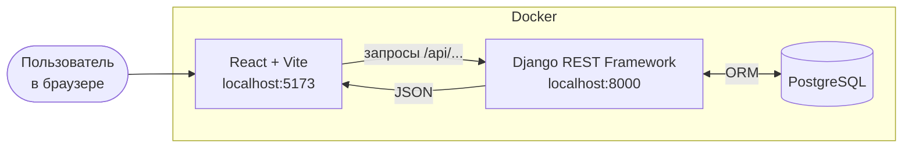

<p align="center">
  
</p>

<h3 align="center">Онлайн-школа подготовки к ОГЭ и ЕГЭ</h3>

<p align="center">
  <em>«Выше» — это не про набор уроков, а маршрут: от стартовой точки до пробного экзамена.</em>
</p>


---

Учебный проект: сайт онлайн-школы с публичной частью (главная страница, страница ОГЭ, форма заявки) и личным кабинетом ученика (курсы, уроки, домашние задания, пробные экзамены). Преподаватель и менеджер работают через админку.

Интерфейс сделан по макету из Figma и написан «с нуля»: фронтенд на React, бэкенд на Django, данные в PostgreSQL, запуск в Docker одной командой.


## Содержание

- [Структура проекта](#структура-проекта)
- [Возможности](#возможности)
- [Как это устроено](#как-это-устроено)
- [Быстрый старт](#быстрый-старт)
- [Демо-доступ](#демо-доступ)
- [Адреса](#адреса)
- [База данных](#база-данных)
- [API](#api)
- [Как наполнять сайт](#как-наполнять-сайт)
- [Настройка](#настройка)
- [Безопасность](#безопасность)
- [Полезные команды](#полезные-команды)
- [Если что-то не работает](#если-что-то-не-работает)


## Структура проекта

```
higherSch/
├── docker-compose.yml        # запуск базы, бэкенда и фронтенда одной командой
├── .env                      # пароли и секреты (не попадает в Git)
├── docs/screenshots/         # скриншоты для README
├── backend/                  # Django
│   ├── Dockerfile
│   ├── requirements.txt
│   ├── config/               # настройки и главные адреса сайта
│   ├── users/                # пользователь (роль, телефон), вход, адрес «кто я»
│   ├── content/              # преподаватели, отзывы, FAQ, команды наполнения базы
│   ├── courses/              # курсы, тарифы, записи, уроки, задания, ответы
│   └── applications/         # заявки с сайта
└── frontend/                 # React
    ├── Dockerfile
    ├── public/               # шрифт, логотипы, фото
    └── src/
        ├── api/              # настройка запросов к бэкенду
        ├── context/          # «кто сейчас вошёл» (AuthContext)
        ├── components/       # блоки: шапка, подвал, тарифы, команда, FAQ, форма заявки
        ├── pages/            # страницы: Home, Exam, Login
        │   └── cabinet/      # страницы личного кабинета
        └── index.css         # весь внешний вид сайта
```

## Возможности

### Для посетителя

- **Главная страница**: первый экран, блок «Как проходит обучение» (вкладки с фото), тарифы, команда преподавателей с переключателем ЕГЭ/ОГЭ, частые вопросы. Тарифы, преподаватели и вопросы берутся из базы данных.
- **Страница ОГЭ**: описание экзамена, предметы, преподаватели, тарифы и вопросы.
- **Форма заявки** с проверкой номера телефона: буквы нельзя ввести, номер приводится к единому виду `+79001234567`. Проверка работает и в браузере, и на сервере.
- **Страница входа** и блок «Я тут впервые» (узнать о платформе или оплатить обучение).

### Для ученика (личный кабинет)

- **Главная кабинета**: мои курсы, процент прохождения, «траектория» баллов (было / сейчас / цель), ближайшие домашки и пробные экзамены.
- **Курсы и уроки**: видео (YouTube или Rutube), конспект, отметка «урок пройден».
- **Домашние задания**: сдача ответа, статус (выполнено / частично / не выполнено), срок, оценка и комментарий преподавателя.
- **Пробный экзамен**: особый тип задания.

### Для преподавателя и менеджера (админка)

- Курсы, уроки и задания: уроки добавляются прямо на странице курса, задания на странице урока.
- Записи учеников на курсы и их баллы.
- Проверка работ: статус, оценка, комментарий.
- Заявки с сайта.

## Как это устроено



React отвечает за то, что видит пользователь. Django с Django REST Framework работает как API: принимает запросы, проверяет права и отдаёт данные в формате JSON. PostgreSQL хранит все данные. Каждая часть запускается в своём контейнере Docker.

| Часть | Технологии |
|---|---|
| Фронтенд | React, Vite, React Router, axios |
| Бэкенд | Python 3.12, Django 5, Django REST Framework, simplejwt (вход по токену), django-cors-headers |
| База данных | PostgreSQL 16 |
| Запуск | Docker, Docker Compose |

## Быстрый старт

### Что нужно

- [Docker Desktop](https://www.docker.com/products/docker-desktop/) (должен быть запущен)
- [Git](https://git-scm.com/)

Python и Node.js на компьютере ставить не нужно: всё работает внутри контейнеров.

### 1. Скачать проект

```bash
git clone https://github.com/lunar0220/higherSch.git
cd higherSch
```

### 2. Создать файл `.env`

В корне проекта (рядом с `docker-compose.yml`) создайте файл `.env`. В нём пароли и секреты, в репозиторий он не попадает.

```env
POSTGRES_DB=vysshe
POSTGRES_USER=vysshe_user
POSTGRES_PASSWORD=придумайте_пароль
POSTGRES_HOST=db
POSTGRES_PORT=5432

SECRET_KEY=придумайте-длинную-случайную-строку
DEBUG=1
```

### 3. Проверить шрифт

Файл шрифта должен лежать здесь: `frontend/public/fonts/Architexture.ttf`. Без него сайт откроется, но текст будет набран запасным шрифтом.

### 4. Запустить

```bash
docker compose up --build -d
```

Первый запуск занимает несколько минут: Docker скачивает образы и устанавливает пакеты. После запуска подождите 20–30 секунд, пока поднимется база.

### 5. Создать таблицы и администратора

```bash
docker compose exec backend python manage.py makemigrations content courses applications
docker compose exec backend python manage.py migrate
docker compose exec backend python manage.py createsuperuser
```

Логин и пароль администратора придумайте сами: он понадобится для входа в админку.

### 6. Заполнить тестовыми данными

Команды выполняются **по порядку**:

```bash
docker compose exec backend python manage.py seed
docker compose exec backend python manage.py update_design_data
docker compose exec backend python manage.py update_faq
docker compose exec backend python manage.py seed_cabinet
```

| Команда | Что делает |
|---|---|
| `seed` | Преподаватели, отзывы, FAQ, курсы, тарифы |
| `update_design_data` | Подгоняет тарифы и факты о преподавателе под макет |
| `update_faq` | Ставит итоговые вопросы и ответы на главной |
| `seed_cabinet` | Демо-ученик, курсы ОГЭ, уроки, задания, баллы |

> [!WARNING]
> Команду `seed` запускайте **один раз и только на пустой базе**: она стирает преподавателей, отзывы, FAQ, тарифы и курсы, а вместе с курсами исчезают их уроки и записи учеников. Остальные три команды безопасно запускать повторно.

### 7. Открыть сайт

Откройте в браузере <http://localhost:5173>.

## Демо-доступ

Чтобы посмотреть личный кабинет, нажмите «Войти» и введите:

| Логин | Пароль |
|---|---|
| `student` | `demo12345` |

В админку <http://localhost:8000/admin> входит администратор, которого вы создали командой `createsuperuser`.

## Адреса

| Что | Адрес |
|---|---|
| Сайт | <http://localhost:5173> |
| Страница ОГЭ | <http://localhost:5173/oge> |
| Вход | <http://localhost:5173/login> |
| Личный кабинет | <http://localhost:5173/cabinet> |
| Админка | <http://localhost:8000/admin> |
| API | <http://localhost:8000/api/> |


## База данных


| Таблица | Что хранит |
|---|---|
| `User` | Ученик или преподаватель: логин, пароль (в виде хеша), роль, телефон |
| `Teacher`, `Review`, `FAQ` | Преподаватели, отзывы и вопросы для сайта |
| `Course`, `Tariff` | Курсы и тарифы. Общие тарифы (Стандарт, Про, Про+) не привязаны к курсу |
| `Enrollment` | Запись ученика на курс и три балла: в начале, сейчас, желаемый |
| `Lesson` | Урок: видео, конспект, порядок |
| `LessonProgress` | Отметка «урок пройден» |
| `Homework` | Задание к уроку. Тип: домашнее задание или пробный экзамен |
| `Submission` | Ответ ученика: статус, оценка, комментарий преподавателя |
| `Application` | Заявка с сайта |

Две важные особенности:

- **Процент прохождения не хранится**, он считается из отметок «урок пройден».
- **Статус «не выполнено» не хранится**: если у ученика нет ответа на задание, значит, он его не сдал.

## API

Все адреса начинаются с `/api/`. Адреса из блока «Кабинет» требуют входа: к запросу нужно приложить токен в заголовке `Authorization: Bearer <токен>`.

### Публичные

| Метод | Адрес | Что делает |
|---|---|---|
| GET | `/teachers/` | Преподаватели (фильтр `?exam_type=oge`) |
| GET | `/tariffs/` | Общие тарифы |
| GET | `/courses/` | Курсы (фильтр `?exam_type=oge`) |
| GET | `/faq/` | Вопросы (без параметра для главной, `?exam_type=oge` для страницы ОГЭ) |
| GET | `/reviews/` | Отзывы |
| POST | `/applications/` | Отправить заявку |
| POST | `/auth/login/` | Войти: `{username, password}`, в ответе токены `access` и `refresh` |
| POST | `/auth/refresh/` | Получить новый `access` по `refresh` |

### Кабинет

| Метод | Адрес | Что делает |
|---|---|---|
| GET | `/auth/me/` | Кто сейчас вошёл |
| GET | `/my/courses/` | Мои курсы с прогрессом и баллами |
| GET | `/my/courses/<id>/` | Курс со списком уроков |
| GET | `/lessons/<id>/` | Урок: видео, конспект, задания |
| POST | `/lessons/<id>/complete/` | Отметить урок пройденным (`{"completed": true}` или `false`) |
| GET | `/my/homework/` | Все задания ученика |
| POST | `/homework/<id>/submit/` | Сдать ответ (`{"answer": "..."}`) |

Ученик видит только те курсы и уроки, на которые он записан: доступ проверяется на сервере.

### Пример запросов

```bash
# 1. Войти и получить токен
curl -X POST http://localhost:8000/api/auth/login/ \
  -H "Content-Type: application/json" \
  -d '{"username": "student", "password": "demo12345"}'

# 2. Запросить свои курсы, подставив access из ответа
curl http://localhost:8000/api/my/courses/ \
  -H "Authorization: Bearer ВАШ_ACCESS_ТОКЕН"
```

## Как наполнять сайт

Всё содержимое меняется в админке <http://localhost:8000/admin>.

| Задача | Где |
|---|---|
| Добавить ученика | Пользователи: роль «Ученик», затем задать пароль |
| Записать ученика на курс | Записи на курсы (там же баллы: в начале, сейчас, желаемый) |
| Добавить урок | Курсы, нужный курс, блок «Уроки» |
| Видео к уроку | Урок, поле «Ссылка на видео» (YouTube или Rutube) |
| Добавить задание или пробник | Уроки, нужный урок, блок «Задания», поле «Тип» |
| Проверить работу | Ответы на задания: статус, оценка, комментарий |
| Посмотреть заявки | Заявки |
| Фото преподавателя | Преподаватели, поле «Фото» |

Регистрации на сайте нет: аккаунт ученика создаёт администратор после оплаты. Новые посетители оставляют заявку.

## Настройка

### Внешний вид

| Что изменить | Где |
|---|---|
| Размер всего сайта | `frontend/src/index.css`, строка `html { font-size: calc(100vw / 160); }`. Чем больше число, тем меньше сайт (при 144 он занимает всю ширину окна) |
| Цвета, поля и промежутки сетки | Блок `:root` в начале `index.css` |
| Тексты и фото вкладок «Как проходит обучение» | Массив `STEPS` в `frontend/src/components/HowItWorks.jsx`, фото в `frontend/public/images/how/` |
| Фото на первом экране | `frontend/public/images/hero-photo.jpg` |
| Логотипы | `frontend/public/images/` |

Размеры в стилях заданы в `rem`: 1rem равен 10 px макета Figma (ширина макета 1440 px). Поэтому размеры из макета достаточно разделить на 10. Сетка: 12 колонок, поля 25 px, промежутки 20 px.

### Настройки бэкенда

Основные настройки находятся в `backend/config/settings.py`:

- база данных, секретный ключ и режим отладки берутся из `.env`;
- `CORS_ALLOWED_ORIGINS` разрешает запросы с адреса фронтенда `http://localhost:5173`;
- `SIMPLE_JWT` задаёт срок жизни токена входа (сутки);
- `AUTH_USER_MODEL = "users.User"` подключает собственную модель пользователя.


## Безопасность

Что реализовано:

- пароли хранятся только в виде хеша;
- вход по токенам (JWT), токен прикладывается только к запросам кабинета;
- все адреса кабинета требуют входа, а доступ к курсу и уроку проверяется по записи ученика;
- номер телефона проверяется и в браузере, и на сервере;
- пароли и секреты лежат в `.env`, который добавлен в `.gitignore`.

## Полезные команды

```bash
docker compose up -d                    # запустить проект
docker compose down                     # остановить
docker compose down -v                  # остановить и стереть базу данных
docker compose ps                       # какие контейнеры работают
docker compose logs backend --tail 50   # логи бэкенда
docker compose logs frontend --tail 50  # логи фронтенда
docker compose restart frontend         # перезапустить фронтенд
```


## Планы развития


- [ ] Онлайн-оплата
- [ ] Страница ЕГЭ
- [ ] Страницы «О нас», «Отзывы», «Вакансии»
- [ ] График траектории баллов
- [ ] Сброс пароля по почте
- [ ] Мобильная версия
- [ ] Автоматическая проверка заданий и тесты

---

<p align="center">Учебный проект</p>
